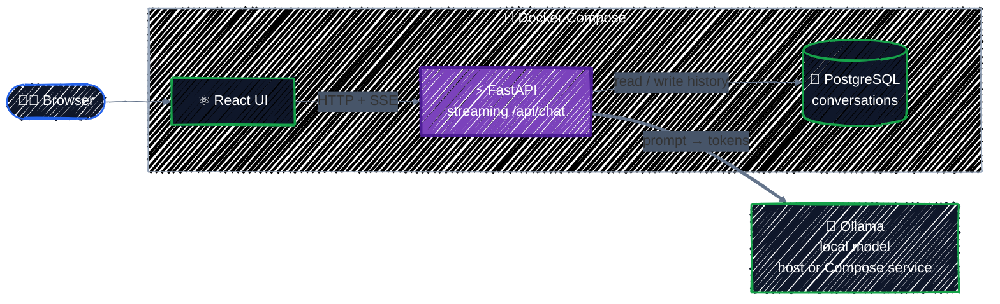
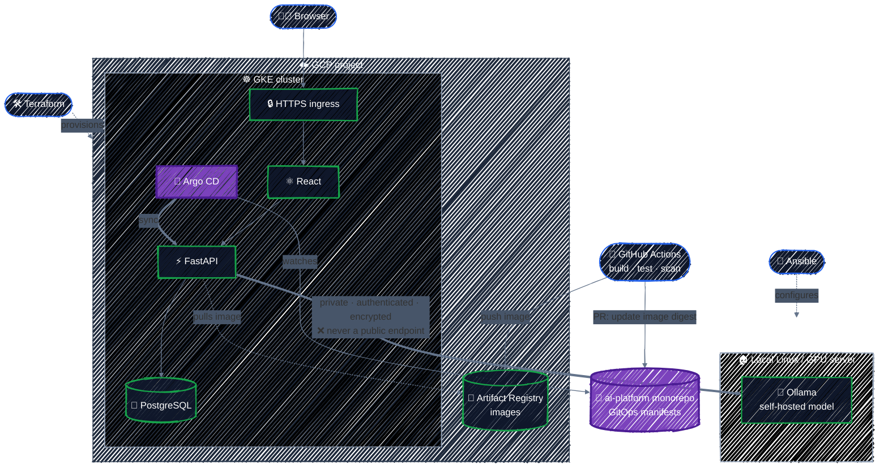
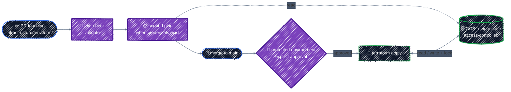

# AI Platform — DevOps & SRE Learning Project

## 1. Project overview

Build a small ChatGPT-like application powered by a **self-hosted open-weight LLM**, while learning how to design, provision, deploy, operate, monitor, and recover a production-like platform.

This is primarily a **DevOps / SRE / GitOps learning project**, not a model-training project. Keep application features intentionally small and invest effort in reproducibility, security, deployment automation, observability, and failure recovery.

**Repository strategy:** One GitHub monorepo (`ai-platform`).

**Primary technologies:** Terraform, Ansible, Kubernetes, GCP, Helm, Argo CD, GitHub Actions, Docker, Prometheus, Grafana, Loki, OpenTelemetry, and k6.

**Application technologies:** FastAPI backend, React frontend, Ollama initially (optional vLLM later), PostgreSQL for conversation history, and optional Redis when justified.

## 2. Goals and non-goals

### Goals
- Provide a usable web chat UI with streaming model responses and persisted conversations.
- Run model inference on user-controlled hardware, not a paid cloud GPU by default.
- Start locally, then deploy application services to Kubernetes, and optionally GKE.
- Manage GCP infrastructure with Terraform and local LLM host configuration with Ansible.
- Package Kubernetes applications using Helm and deploy via Argo CD GitOps.
- Implement CI checks, immutable container images, security scanning, and controlled deployment promotion.
- Measure reliability, perform load tests, simulate failures, and document recovery procedures.
- Keep cloud costs bounded and make teardown repeatable.

### Non-goals for the MVP
- Training or fine-tuning an LLM.
- RAG, agents, tool calling, Kafka, service mesh, multi-region HA, or complex auth.
- Exposing Ollama or the local inference endpoint directly to the public internet.
- Pretending that a learning deployment meets production compliance requirements.

## 3. Architecture and deployment modes

### Local-first (required)



Run the first version with Docker Compose. Provide a streaming chat endpoint, basic health checks, and database persistence. Ollama can run on the host or as a Compose service, depending on hardware.

### Local Kubernetes (required before GCP)

Use kind or k3d for the app, Helm packaging, Argo CD, and observability. Keep the LLM endpoint reachable only through a deliberate local networking arrangement; do not assume a container's `localhost` resolves to the host.

### Hybrid GCP deployment (later)



Terraform provisions GCP networking, IAM, Artifact Registry, GKE, and remote-state prerequisites. Ansible provisions the local inference host. Argo CD manages application deployments within Kubernetes. **Do not expose Ollama directly over a public endpoint.** Evaluate VPN/private connectivity, routing, firewall policy, DNS, authentication, and TLS before enabling hybrid inference. If secure connectivity is not available, keep the complete demo local rather than implementing an insecure shortcut.

**Cost warning:** GKE control plane, nodes, load balancers, NAT, disks, logging, and registries can incur charges. Budget alerts are not hard spending caps. Provision GKE only when ready to test and destroy it afterward. Audit residual resources not managed by Terraform.

## 4. Monorepo structure (target, create incrementally)

```text
ai-platform/
├── apps/
│   ├── frontend/                    # React chat UI
│   └── backend/                     # FastAPI and tests
├── infrastructure/
│   ├── terraform/
│   │   ├── modules/
│   │   │   ├── network/
│   │   │   ├── gke/
│   │   │   ├── iam/
│   │   │   └── artifact-registry/
│   │   └── environments/
│   │       ├── dev/
│   │       └── prod/               # Add only when needed
│   └── ansible/
│       ├── inventories/
│       ├── playbooks/
│       └── roles/
│           ├── docker/
│           ├── ollama/
│           └── monitoring/
├── deploy/
│   ├── helm/ai-platform/
│   │   ├── Chart.yaml
│   │   ├── values.yaml
│   │   └── templates/
│   └── argocd/
│       ├── applications/
│       └── environments/
│           ├── dev/
│           └── prod/
├── observability/
│   ├── prometheus/
│   ├── grafana/
│   └── alerts/
├── tests/
│   └── load/                       # k6 scenarios
├── docs/
│   ├── architecture.md
│   ├── decisions/
│   ├── runbooks/
│   └── cost-and-teardown.md
├── .github/workflows/
│   ├── ci.yml
│   ├── terraform.yml
│   └── security.yml
├── docker-compose.yml
├── Makefile
├── .gitignore
├── README.md
└── PROJECT_PLAN.md
```

The tree is an intended end state, **not a request to generate empty folders and boilerplate all at once**.

## 5. Responsibilities and boundaries

| Tool | Responsibility | Learning outcomes |
|---|---|---|
| Terraform | GCP resource provisioning | Providers, modules, state, IAM, dependencies, environments |
| Ansible | Local Linux/GPU host configuration | Inventory, roles, idempotency, service configuration, secrets |
| Kubernetes | Application orchestration | Deployments, Services, probes, resources, rollout, scaling |
| Helm | Kubernetes application packaging | Charts, templates, values, versioning |
| Argo CD | GitOps continuous deployment | Desired state, reconciliation, drift, rollback |
| GitHub Actions | CI and GitOps change automation | Tests, image builds, scanning, OIDC, path filters |
| GCP | Cloud platform | GKE, Artifact Registry, networking, IAM, billing |
| Prometheus/Grafana | Metrics and dashboards | RED metrics, SLOs, alerting |
| Loki/OpenTelemetry | Logs and traces | Correlation, distributed troubleshooting |
| k6 | Load and reliability testing | Throughput, latency, capacity |

**Ownership rule:** Terraform manages cloud infrastructure; Argo CD manages Kubernetes application resources; Ansible manages the local inference host. Avoid overlapping ownership of the same resource. Cluster bootstrap may require an explicitly documented one-time step.

## 6. Minimal application contract

- `GET /health/live`: process liveness; should not fail simply because the model is slow.
- `GET /health/ready`: readiness for serving API requests; define dependency behavior deliberately.
- `POST /api/chat`: accept a user message and conversation identifier, stream generated tokens using SSE or another documented protocol.
- `GET /api/conversations`: list saved conversations.
- `GET /api/conversations/{id}`: fetch messages.
- Store conversations/messages in PostgreSQL with a migration mechanism.
- Configure model base URL, model name, DB connection, timeouts, and log level via environment/configuration, not hardcoded values.
- Include request IDs, structured logs, error handling, input size limits, inference timeout handling, and safe client-facing errors.
- Keep the UI basic: prompt entry, streaming answer, loading/error state, and conversation history.
- The initial demo may be single-user. Add authentication before exposing personal conversation data to other users or the public internet.

## 7. CI/CD and GitOps design

### Pull request checks
1. Run backend formatting/linting and unit tests.
2. Run frontend lint/build checks.
3. Validate Helm charts and render templates.
4. Validate Terraform formatting and configuration when infrastructure paths change.
5. Run dependency/image scanning where applicable.
6. Use path filters so unrelated edits do not trigger all workflows.

### Build and deploy

```mermaid
---
config:
  look: handDrawn
  theme: default
  themeVariables:
    fontFamily: '"Comic Sans MS", "Comic Sans", "Segoe Print", "Bradley Hand", cursive'
    clusterBkg: '#FAFAFA'
    clusterBorder: '#94A3B8'
    lineColor: '#64748B'
    edgeLabelBackground: '#475569'
  themeCSS: |
    .edgeLabel, .edgeLabel p, .edgeLabel span { color: #FFFFFF !important; }
---
flowchart LR
    merge(["🔀 merge to main"])

    subgraph ci["🤖 GitHub Actions · CI"]
        direction TB
        build["🧪 build + test images"]
        scan["🔍 scan images"]
        push["🐳 push to Artifact Registry<br/>OIDC / WIF · no SA key"]
        bump["📝 bot PR<br/>update Helm image digest"]
        build --> scan --> push --> bump
    end

    approve{"👀 review +<br/>merge GitOps PR"}

    subgraph cd["🐙 Argo CD · CD"]
        direction TB
        sync["🔄 detect Git change<br/>sync app path"]
        verify["📈 verify rollout<br/>health + metrics"]
        sync --> verify
    end

    merge --> build
    bump --> approve
    approve -->|"approved"| sync
    verify -. "❌ unhealthy:<br/>git revert GitOps change" .-> sync

    classDef ctrl fill:#0F172A,stroke:#2563EB,stroke-width:2px,color:#FFFFFF
    classDef eng fill:#7B42BC,stroke:#4C1D95,stroke-width:3px,color:#FFFFFF
    classDef tgt fill:#0F172A,stroke:#16A34A,stroke-width:2px,color:#FFFFFF
    class merge ctrl
    class build,scan,push,bump,approve eng
    class sync,verify tgt
    style ci fill:#000000,stroke:#94A3B8,color:#FFFFFF,fillStyle:solid
    style cd fill:#000000,stroke:#94A3B8,color:#FFFFFF,fillStyle:solid
```



1. Merge approved application code to `main`.
2. GitHub Actions builds and tests images, scans them, and pushes to Artifact Registry.
3. Authenticate GitHub Actions to GCP using Workload Identity Federation/OIDC rather than a stored long-lived service account key.
4. Pin deployments by immutable image digest (preferred) or immutable version tag.
5. A bot or workflow opens a PR updating the Helm image reference in the **same monorepo**.
6. After approval/merge, Argo CD detects the Git change and syncs the designated application path.
7. Verify rollout health and metrics. Roll back by reverting the GitOps change, with emergency rollback procedures documented.

Do not have both GitHub Actions and Argo CD independently run application deployment operations. Avoid workflows that continuously commit to themselves. Use least-privilege permissions and GitHub environment approvals for sensitive operations.

### Terraform workflow



- PR: `terraform fmt -check`, `terraform validate`, and a scoped plan when credentials are available.
- Apply: separate, protected, explicitly approved workflow; do not auto-apply every code push.
- Remote state: GCS backend with appropriate access control; document bootstrap of the state bucket.
- Never commit `*.tfstate`, `.terraform/`, credentials, or real secrets.

## 8. Reliability and security requirements

### Kubernetes
- Set CPU/memory requests and limits appropriate to workloads.
- Implement startup/readiness/liveness probes with correct semantics.
- Use rolling updates and validate behavior during pod restarts.
- Define graceful shutdown and timeouts for streaming responses.
- Add HPA only after establishing meaningful metrics and realistic resource requests.
- Use Kubernetes Secrets or a managed secret integration; do not commit plaintext secrets.

### Hybrid connectivity
- Default deny for public inference access.
- Encrypt and authenticate traffic between GKE and the local model server.
- Restrict ingress to required sources and ports; document routing and DNS.
- Assume home networks may have dynamic IPs, NAT, and no inbound connectivity.
- Avoid promising VPN connectivity before validating the user's network/hardware constraints.

### Observability
- Metrics: API request rate, error rate, p95 latency, inference time-to-first-token, token throughput, resource usage.
- Logs: structured application logs with request IDs; never log secrets or full private prompts by default.
- Traces: API-to-model timing and database operations with OpenTelemetry.
- Alerts: elevated 5xx rate, sustained latency, service unavailability, and resource saturation.
- Define a **provisional** API availability SLO (e.g., 99.9%) only after deciding what counts as a valid request and an error. Treat targets as learning goals, not measured results.

### Failure exercises
- Delete an API Pod and verify self-healing.
- Deploy a broken image and verify safe rollback.
- Simulate inference timeout/unavailability and ensure graceful error responses.
- Run k6 load tests and identify bottlenecks.
- Simulate PostgreSQL interruption and verify recovery.
- Document incident timeline, detection, mitigation, and follow-up in `docs/runbooks/`.

## 9. Implementation roadmap and acceptance criteria

```mermaid
---
config:
  look: handDrawn
  theme: default
  themeVariables:
    fontFamily: '"Comic Sans MS", "Comic Sans", "Segoe Print", "Bradley Hand", cursive'
    lineColor: '#64748B'
    edgeLabelBackground: '#475569'
  themeCSS: |
    .edgeLabel, .edgeLabel p, .edgeLabel span { color: #FFFFFF !important; }
---
flowchart LR
    p1["1️⃣ Local chatbot MVP<br/>FastAPI · Ollama · Postgres<br/>⭐ first priority"]
    p2["2️⃣ Local Kubernetes<br/>kind/k3d + Helm"]
    p3["3️⃣ Terraform + GCP<br/>VPC · IAM · AR · state"]
    p4["4️⃣ GitHub Actions<br/>+ Argo CD"]
    p5["5️⃣ Ansible +<br/>hybrid inference"]
    p6["6️⃣ SRE +<br/>observability"]

    p1 --> p2 --> p3 --> p4 --> p5 --> p6

    classDef ctrl fill:#0F172A,stroke:#2563EB,stroke-width:2px,color:#FFFFFF
    classDef eng fill:#7B42BC,stroke:#4C1D95,stroke-width:3px,color:#FFFFFF
    classDef tgt fill:#0F172A,stroke:#16A34A,stroke-width:2px,color:#FFFFFF
    class p1 eng
    class p2,p3,p4,p5 ctrl
    class p6 tgt
```



### Phase 1 — Local chatbot MVP (first priority)
**Scope:** FastAPI, Ollama, PostgreSQL, basic React UI, Docker Compose.

**Acceptance:**
- One documented command starts the local stack, assuming a model is already available or a documented model pull step is completed.
- A user can submit a prompt and see streaming tokens.
- Conversation history survives an app container restart.
- Health endpoints and basic unit tests work.
- `README.md` contains prerequisites, configuration, commands, and troubleshooting.

### Phase 2 — Local Kubernetes + Helm
**Scope:** kind/k3d, Deployment, Service, probes, Helm chart.

**Acceptance:**
- Helm installs/upgrades the app in a local cluster.
- Configuration changes via values files.
- Restarting an API Pod recovers service.
- Inference networking is documented and works without exposing the model publicly.

### Phase 3 — Terraform + GCP
**Scope:** GCP networking, IAM, Artifact Registry, GCS remote state, optional GKE.

**Acceptance:**
- `terraform fmt`, `validate`, `plan`, and approved `apply` work.
- State is remote and not committed to Git.
- Cloud resources are tagged/labeled where appropriate.
- Teardown instructions and residual-cost checks are documented.
- GKE is created only after a cost estimate and user approval.

### Phase 4 — GitHub Actions + Argo CD
**Scope:** CI, image build/push, GitOps image update, Argo CD sync.

**Acceptance:**
- PR checks run only for relevant changed paths.
- Main-branch build produces an immutable image reference.
- Updating GitOps configuration deploys a new version through Argo CD.
- A Git revert restores the previous version.
- No long-lived GCP service account key is required in GitHub.

### Phase 5 — Ansible + hybrid inference
**Scope:** Linux host bootstrap, Ollama service, monitoring agent, secure GKE-to-host connectivity.

**Acceptance:**
- Re-running Ansible is idempotent.
- Ollama runs as a managed service with logs and restart policy.
- GKE can reach the model through an authenticated encrypted path.
- The inference endpoint is not publicly accessible.

### Phase 6 — SRE and observability
**Scope:** Prometheus, Grafana, Loki, OpenTelemetry, k6, alerting, runbooks.

**Acceptance:**
- A dashboard shows request rate, errors, latency, and system resources.
- A trace explains where a chat request spends time.
- At least three failure drills have documented outcomes.
- Alerts trigger on deliberately induced test failures.
- The project has a clear operations and incident response guide.

**Schedule:** Approximately 8–12 weeks of part-time work, subject to hardware, learning pace, and GCP networking complexity. Milestones matter more than calendar dates.

## 10. Open decisions to resolve before relevant phases

- Host OS and available RAM/CPU/GPU/VRAM.
- Ollama model name and acceptable response latency.
- Whether the user has an existing GCP project and billing budget.
- GKE Standard vs Autopilot and expected cluster runtime.
- Domain name, TLS, and exposure policy for the web UI.
- Connectivity from GKE to the local host (VPN/overlay network, firewall, routing).
- Whether PostgreSQL should run in-cluster for the demo or use a managed service later.

Do not invent answers to these. Use safe local defaults and ask when the decision becomes blocking.

## 11. Instructions for Codex

You are an implementation assistant for this repository. Follow these rules:

1. **Work incrementally.** Start with Phase 1 only. Do not scaffold all six phases or provision cloud resources without explicit instruction.
2. Before each substantial change, explain the intended files, dependencies, commands, and acceptance criteria briefly.
3. Prefer the smallest working implementation over premature abstractions.
4. Keep infrastructure, app, and deployment concerns separated by directory and ownership.
5. Use current, maintained versions; verify compatibility rather than inventing version numbers.
6. Never commit secrets, private keys, state files, tokens, or model conversation data.
7. Do not run paid GCP operations, `terraform apply`, `terraform destroy`, or destructive database commands without explicit approval.
8. Add tests and documentation alongside features; report what was actually run and what could not be verified.
9. Prefer reproducible commands and a Makefile for common development tasks.
10. When there are multiple reasonable options, explain tradeoffs and recommend a simple default.
11. Keep all changes reviewable. Avoid large unrelated refactors.
12. Preserve the one-repository strategy unless explicitly instructed otherwise.

### First Codex task

> Read `PROJECT_PLAN.md`. Propose a concrete Phase 1 implementation plan for the local chatbot MVP, including architecture, API contract, minimal directory structure, Docker Compose services, configuration, test strategy, and exact acceptance checks. Ask about hardware only where it blocks the Ollama choice. Do **not** implement Phase 2+, create GCP resources, or execute destructive commands. After presenting the plan, wait for approval before coding.

## 12. Definition of done for the overall project

The project is complete when a reviewer can clone the repository, follow documented prerequisites, run the local chatbot, understand the Terraform/Ansible/Kubernetes/Helm/Argo CD responsibilities, reproduce CI/CD and deployment in a controlled environment, inspect reliability dashboards, and repeat documented failure/recovery exercises without relying on undocumented manual steps.
